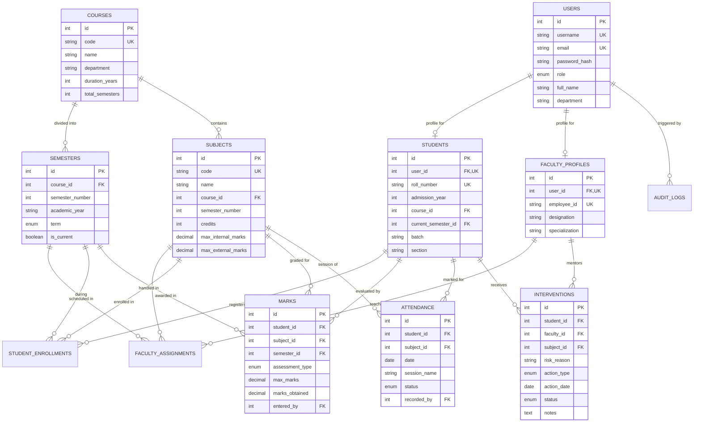

# Student Performance Analytics & Management System (SPAMS)
## Relational Database Management System (DBMS) Design Document

This document describes the relational database design, 3NF normalization analysis, ER diagram, SQL views, stored procedures, triggers, and transactions implemented in **SPAMS**.

---

## 1. Entity-Relationship (ER) Diagram



---

## 2. Relational Schema Normalization Analysis (Up to 3NF)

A relational database is in **Third Normal Form (3NF)** if and only if:
1. It is in **First Normal Form (1NF)**: Every attribute contains only atomic (indivisible) values, and each record is unique.
2. It is in **Second Normal Form (2NF)**: It is in 1NF and contains no *partial functional dependencies* (no non-prime attribute depends on a proper subset of a composite primary key).
3. It is in **Third Normal Form (3NF)**: It is in 2NF and contains no *transitive functional dependencies* (no non-prime attribute depends on another non-prime attribute; $X \rightarrow Y \implies X$ is a superkey or $Y$ is a prime attribute).

### Functional Dependency & Normalization Breakdown

#### A. Users & Authentication (`users`)
- **Attributes:** $\{ \text{id}, \text{username}, \text{email}, \text{password\_hash}, \text{role}, \text{full\_name}, \text{phone}, \text{department} \}$
- **Candidate Keys:** $\{ \text{id} \}$, $\{ \text{username} \}$, $\{ \text{email} \}$
- **Primary Key:** $\text{id}$
- **Dependencies:**
  - $\text{id} \rightarrow \text{username}, \text{email}, \text{password\_hash}, \text{role}, \text{full\_name}, \text{phone}, \text{department}$
- **Normalization:**
  - **1NF:** All fields store atomic scalar strings/enums. No multivalued arrays.
  - **2NF:** The primary key is a single attribute ($\text{id}$), so no partial dependencies exist.
  - **3NF:** No non-key attribute determines another non-key attribute. Hence, 3NF is satisfied.

#### B. Student Profiles (`students`)
- **Decomposition Rationale:** Instead of denormalizing student-specific academic attributes (like roll number, batch, admission year) into `users`, a separate table `students` is created with a foreign key $\text{user\_id} \rightarrow \text{users(id)}$.
- **Candidate Keys:** $\{ \text{id} \}$, $\{ \text{user\_id} \}$, $\{ \text{roll\_number} \}$
- **Dependencies:**
  - $\text{id} \rightarrow \text{user\_id}, \text{roll\_number}, \text{admission\_year}, \text{course\_id}, \text{current\_semester\_id}, \text{batch}, \text{section}$
- **Normalization:**
  - No transitive attributes (course name, faculty details, semester terms are stored exclusively in their respective relations `courses` and `semesters`). Satisfies 3NF.

#### C. Subjects & Courses (`courses`, `subjects`)
- **Separate Entities:** Course info ($\text{code}, \text{name}, \text{duration}$) is separated from Subject info ($\text{code}, \text{name}, \text{credits}, \text{max\_marks}$).
- If course title was stored directly in `subjects`, we would have:
  $$\text{subject\_id} \rightarrow \text{course\_id} \rightarrow \text{course\_name}$$
  which is a transitive dependency violating 3NF!
- By decomposing into `courses(id, code, name)` and `subjects(id, code, name, course_id)`, the transitive dependency is eliminated, achieving clean 3NF.

#### D. Faculty Assignments (`faculty_assignments`)
- **Decomposition:** Many-to-many relationship between faculty and subjects for a given semester is normalized into an associative relation:
  $$\text{id} \rightarrow \text{faculty\_id}, \text{subject\_id}, \text{semester\_id}, \text{section}$$
  with a composite unique constraint $(\text{faculty\_id}, \text{subject\_id}, \text{semester\_id}, \text{section})$.
- Prevents duplication of teacher profile details in subject records.

#### E. Marks Management (`marks`)
- **Attributes:** $\{ \text{id}, \text{student\_id}, \text{subject\_id}, \text{semester\_id}, \text{assessment\_type}, \text{max\_marks}, \text{marks\_obtained}, \text{entered\_by}, \text{remarks} \}$
- **Candidate Keys:** $\{ \text{id} \}$, $\{ (\text{student\_id}, \text{subject\_id}, \text{semester\_id}, \text{assessment\_type}) \}$
- **Dependencies:**
  - No grade or grade point is stored persistently in the base table. Grade calculation depends on $(\text{marks\_obtained} / \text{max\_marks})$, which would violate 3NF if stored redundantly.
  - Grades and SGPA are derived dynamically through SQL Views and queries. Satisfies 3NF.

#### F. Attendance Ledger (`attendance`)
- **Atomic Log:** Each session per student per subject is recorded atomically:
  $$(\text{student\_id}, \text{subject\_id}, \text{date}, \text{session\_name}) \rightarrow \text{status}, \text{recorded\_by}, \text{notes}$$
- Attendance percentages are not stored statically in student records, preventing update anomalies when new sessions are recorded.

---

## 3. Real DBMS Implementation Features

### A. SQL Views

1. **`v_student_attendance_summary`**:
   Aggregates student lecture presence dynamically:
   ```sql
   CREATE OR REPLACE VIEW v_student_attendance_summary AS
   SELECT 
       a.student_id,
       s.roll_number,
       u.full_name AS student_name,
       sub.id AS subject_id,
       sub.code AS subject_code,
       sub.name AS subject_name,
       COUNT(a.id) AS total_sessions,
       SUM(CASE WHEN a.status IN ('Present', 'Excused') THEN 1 ELSE 0 END) AS attended_sessions,
       SUM(CASE WHEN a.status = 'Absent' THEN 1 ELSE 0 END) AS absent_sessions,
       ROUND((SUM(CASE WHEN a.status IN ('Present', 'Excused') THEN 100.0 ELSE 0.0 END) / COUNT(a.id)), 2) AS attendance_percentage
   FROM attendance a
   JOIN students s ON a.student_id = s.id
   JOIN users u ON s.user_id = u.id
   JOIN subjects sub ON a.subject_id = sub.id
   GROUP BY a.student_id, s.roll_number, u.full_name, sub.id, sub.code, sub.name;
   ```

2. **`v_student_subject_marks`**:
   Computes aggregated internal and exam percentages and assigns letter grades based on the 10-point credit scale:
   ```sql
   CREATE OR REPLACE VIEW v_student_subject_marks AS
   SELECT 
       m.student_id, s.roll_number, u.full_name AS student_name,
       m.semester_id, sem.semester_number, m.subject_id,
       sub.code AS subject_code, sub.name AS subject_name, sub.credits,
       SUM(m.max_marks) AS total_max_marks,
       SUM(m.marks_obtained) AS total_marks_obtained,
       ROUND((SUM(m.marks_obtained) * 100.0) / NULLIF(SUM(m.max_marks), 0), 2) AS percentage,
       CASE 
           WHEN (SUM(m.marks_obtained) * 100.0) / NULLIF(SUM(m.max_marks), 0) >= 90 THEN 'O'
           WHEN (SUM(m.marks_obtained) * 100.0) / NULLIF(SUM(m.max_marks), 0) >= 80 THEN 'A+'
           WHEN (SUM(m.marks_obtained) * 100.0) / NULLIF(SUM(m.max_marks), 0) >= 70 THEN 'A'
           WHEN (SUM(m.marks_obtained) * 100.0) / NULLIF(SUM(m.max_marks), 0) >= 60 THEN 'B+'
           WHEN (SUM(m.marks_obtained) * 100.0) / NULLIF(SUM(m.max_marks), 0) >= 50 THEN 'B'
           WHEN (SUM(m.marks_obtained) * 100.0) / NULLIF(SUM(m.max_marks), 0) >= 40 THEN 'P'
           ELSE 'F'
       END AS estimated_grade,
       CASE 
           WHEN (SUM(m.marks_obtained) * 100.0) / NULLIF(SUM(m.max_marks), 0) >= 90 THEN 10.0
           WHEN (SUM(m.marks_obtained) * 100.0) / NULLIF(SUM(m.max_marks), 0) >= 80 THEN 9.0
           WHEN (SUM(m.marks_obtained) * 100.0) / NULLIF(SUM(m.max_marks), 0) >= 70 THEN 8.0
           WHEN (SUM(m.marks_obtained) * 100.0) / NULLIF(SUM(m.max_marks), 0) >= 60 THEN 7.0
           WHEN (SUM(m.marks_obtained) * 100.0) / NULLIF(SUM(m.max_marks), 0) >= 50 THEN 6.0
           WHEN (SUM(m.marks_obtained) * 100.0) / NULLIF(SUM(m.max_marks), 0) >= 40 THEN 5.0
           ELSE 0.0
       END AS grade_point
   FROM marks m
   JOIN students s ON m.student_id = s.id
   JOIN users u ON s.user_id = u.id
   JOIN semesters sem ON m.semester_id = sem.id
   JOIN subjects sub ON m.subject_id = sub.id
   GROUP BY m.student_id, s.roll_number, u.full_name, m.semester_id, sem.semester_number, m.subject_id, sub.code, sub.name, sub.credits;
   ```

3. **`v_student_semester_summary`**:
   Calculates semester grade point average (SGPA) by weighing subject grade points with subject credits:
   $$\text{SGPA} = \frac{\sum (\text{Grade Point} \times \text{Credits})}{\sum \text{Credits}}$$

---

### B. Stored Procedures

1. **`sp_calculate_student_cgpa(IN p_student_id INT, OUT p_cgpa DECIMAL(4,2), OUT p_total_credits INT, OUT p_total_semesters INT)`**:
   Computes cumulative GPA across all completed semesters weighted by credits.
2. **`sp_get_at_risk_students(IN p_course_id INT, IN p_semester_id INT)`**:
   Executes a multi-table analytical query joining attendance and marks summaries against configurable thresholds to return flagged student IDs with explicit risk indicators.

---

### C. Triggers

1. **`trg_audit_marks_update` (AFTER UPDATE ON marks)**:
   Whenever an existing mark is updated, automatically inserts a record into `audit_logs` storing the timestamp, user ID, previous marks, and new marks.
2. **`trg_validate_marks_before_insert` (BEFORE INSERT ON marks)**:
   Enforces database-level constraint integrity: raises SQL state `45000` if `marks_obtained < 0` or `marks_obtained > max_marks`.

---

### D. Transactions & ACID Compliance

- Used in batch marks entry: all student scores for an assessment either commit together or rollback if any record fails validation.
- Used in daily batch attendance recording: all student records for a class session are committed in a single atomic transaction.
